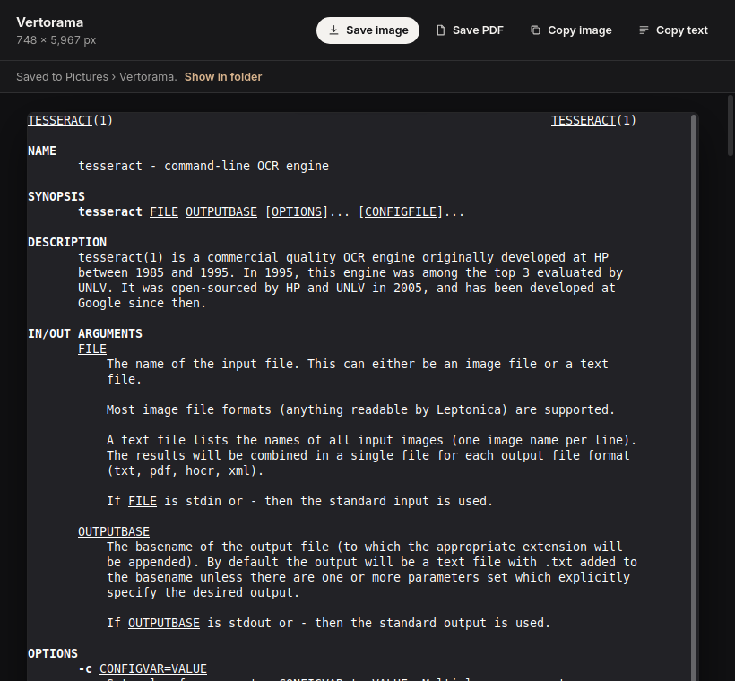

# Vertorama

Capture a whole scrolling area as one tall image: a long chat, a web page, a
document, a manual page in a terminal. Not just the part that fits on screen.



Press **Super+Shift+S** and drag over the area that scrolls. Vertorama
scrolls it for you, a step at a time, and joins the steps into one image. It
stops by itself at the end; move the mouse to stop sooner and keep what it
has so far.

Then:

- **Save image**, a PNG
- **Save PDF**, split into pages between lines of text, with the text
  searchable and selectable
- **Copy image** or **Copy text**

Saved files go to Pictures › Vertorama. Everything runs on your computer.

## How it joins the steps

Each step is matched against the last one by its pixels, to find exactly how
far the content moved:

- Every row of pixels gets a rough fingerprint. Rows that are common within
  a step (blank space, repeated lines) are ignored; every other row votes for
  how far it moved, and the best few answers are checked against the actual
  pixels.
- Bars that don't scroll with the content, like a chat's title bar and
  message box or the status line in `less`, are found and kept once, at the
  top and bottom. That includes bars whose text changes from step to step.
- A blinking cursor or an animated picture only spoils its own rows, so it
  doesn't throw the matching off.
- New strips are cut a little above the bottom edge, where many apps draw a
  shadow or a "more below" line while scrolling.
- If two steps can't be matched, Vertorama goes back and takes smaller steps.
  If they still can't be matched, it stops there instead of guessing.

Before scrolling it also makes sure the window you selected is the one on
top, in case closing the selection screen put a different window in front.

## Install

Get the code, then run the setup script. It checks what Vertorama needs and,
if anything is missing, shows the exact command for your distro:

```sh
git clone https://github.com/BeansAsset/vertorama.git ~/vertorama
~/vertorama/install-integration.sh
```

What it needs, if you'd rather install it first:

| Distro | Command |
| --- | --- |
| Linux Mint, Ubuntu, Debian, Pop!_OS | `sudo apt install tesseract-ocr python3-gi python3-pil gir1.2-gtk-3.0 gir1.2-webkit2-4.1 python3-xlib` |
| Fedora | `sudo dnf install tesseract tesseract-langpack-eng python3-gobject python3-pillow gtk3 webkit2gtk4.1 python3-xlib` |
| Arch, Manjaro | `sudo pacman -S --needed tesseract tesseract-data-eng python-gobject python-pillow gtk3 webkit2gtk-4.1 python-xlib` |
| openSUSE | `sudo zypper install tesseract-ocr tesseract-ocr-traineddata-english python3-gobject python3-Pillow typelib-1_0-Gtk-3_0 typelib-1_0-WebKit2-4_1 python3-python-xlib` |

Tesseract is only used for Save PDF and Copy text.

The setup script adds Vertorama to your apps menu, starts it quietly at login
so the shortcut responds instantly, and sets **Super+Shift+S** (Super is the
Windows key) on Cinnamon, GNOME, Budgie, MATE, Xfce and KDE. On other
desktops it tells you what to bind. On KDE, Spectacle uses the same shortcut
for its own region capture; change one of them in System Settings ›
Shortcuts. `install-integration.sh --remove` undoes all of it.

Vertorama needs an X11 session for now: on Wayland one app can't scroll
another's window. A version where you scroll by hand, for Wayland, is
planned. It handles HiDPI and works on the monitor your pointer is on.

Tested on Linux Mint 22 (Cinnamon, X11). Other desktops and distros are
covered by the setup script's tests but not yet by hand; reports are welcome.
Reads English for now.

## Run it by hand

```sh
./vertorama-app                  # freeze the screen and select an area
./vertorama-app --background     # start quietly, ready for the shortcut
```

## Files

```
vertorama/
  main.py        the app: the selection screen, the progress note, the result window
  capture.py     the screenshot the selection is drawn on (X11)
  scroll.py      scrolling, waiting for the content to settle, capturing each step
  stitch.py      joining the steps: finding each shift, the fixed bars
  output.py      PDF pages, the searchable PDF, the text
  bridge.py      a window holding one of the web pages, and how they talk
  web/           the selection screen and result window (HTML, CSS, JS, Inter font)
tools/
  integrate.py   setup for any common distro and desktop
tests/           python3 -m unittest discover -s tests
```

## License

GPL-3.0-or-later (`LICENSE`). Inter is under the SIL Open Font License 1.1.
